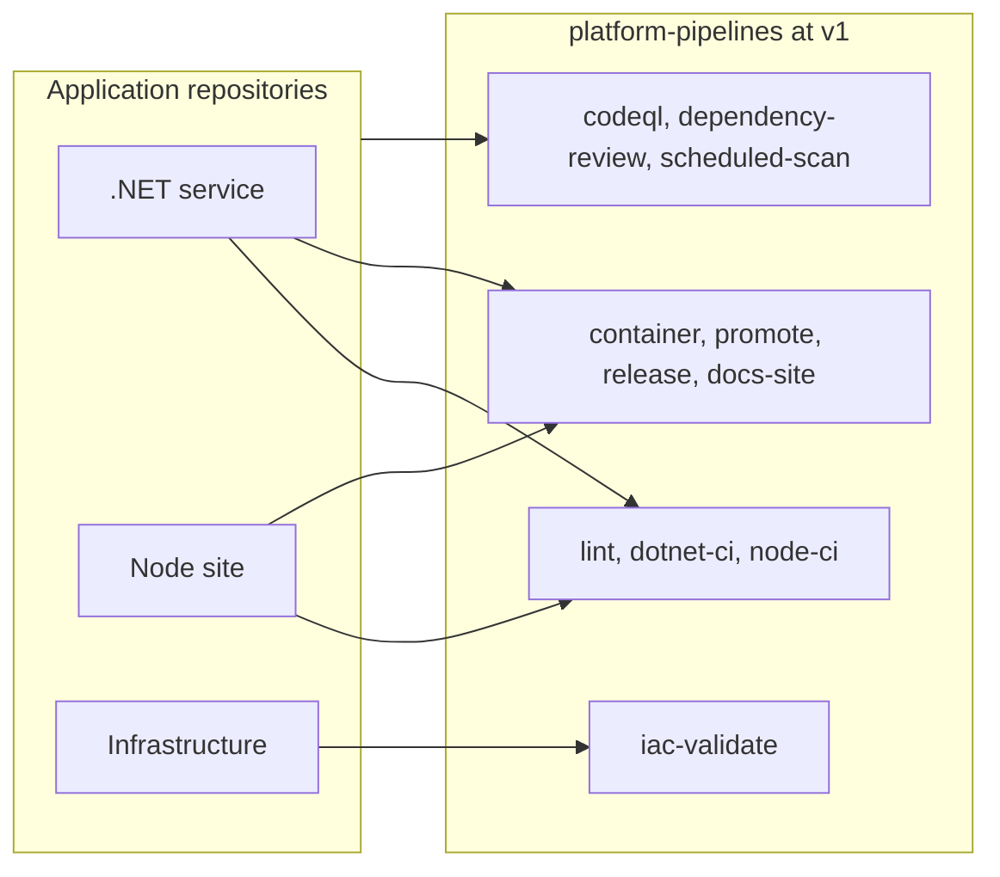
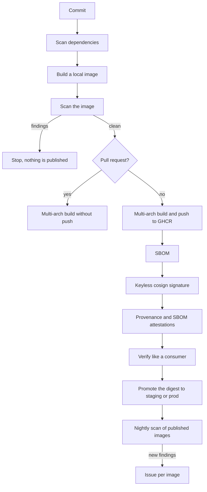
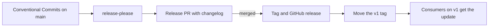

# Architecture

Application repositories call this library instead of keeping their own pipelines.
The library stays in one place and is released with versions, so a fix reaches
every consumer through a version bump.

## How a repository uses the library

## From commit to verified image

Nothing reaches the registry before the scans pass, and everything after the push
works on the digest, because a tag can be moved. See
[ADR 0003](adr/0003-gate-before-publish-sign-by-digest.md) and
[ADR 0004](adr/0004-build-once-promote-by-digest.md).

## From commit to release

## How the library is tested

| Layer | Workflow | Question it answers |
| --- | --- | --- |
| Static | `reusable-lint` | Are the workflows themselves valid? |
| Local paths | `ci.yml` and the other callers | Does this branch work on real example code? |
| Released version | `consumer-demo.yml` | Does `@v1` work from the outside? |
| Negative tests | `workflow-tests.yml`, `conftest verify` | Do the gates stop what they should stop? |
